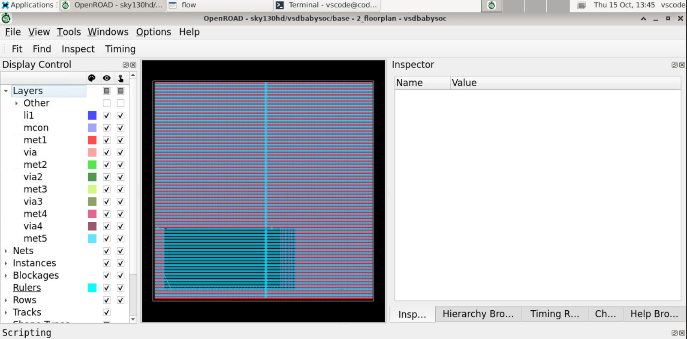
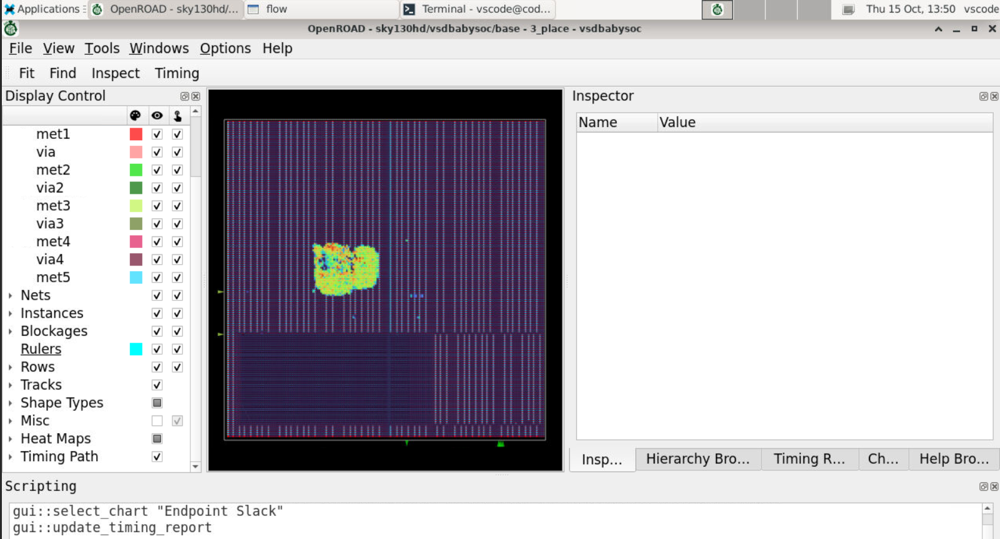
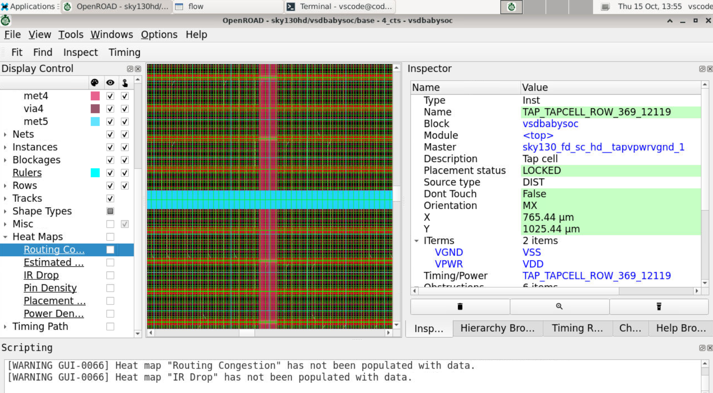
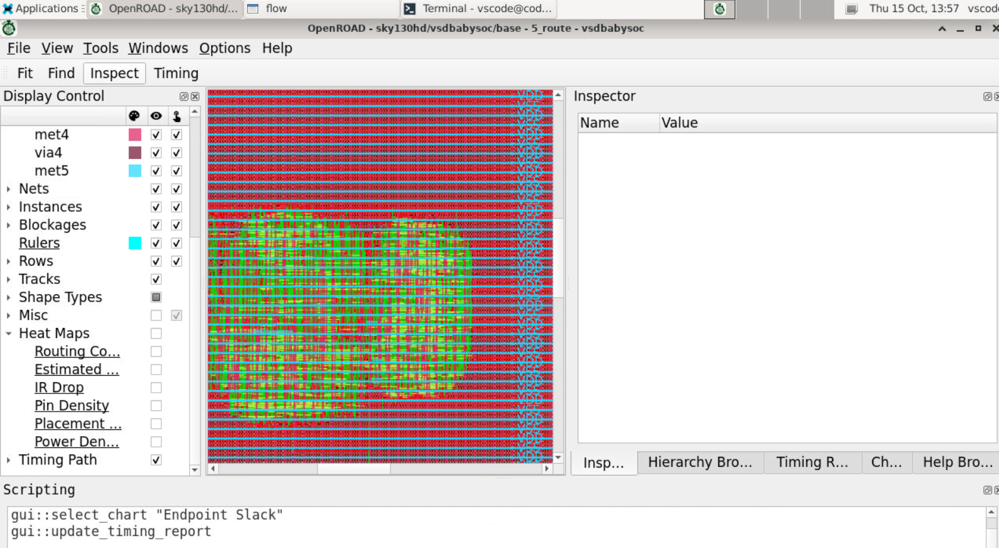

# OpenROAD Physical Design Flow — VSDBabySoC Using Sky130HD

## Overview

This project demonstrates the physical design flow of VSDBabySoC using OpenROAD and the Sky130HD platform. The design is examined at different stages of physical implementation through the OpenROAD graphical user interface.

The main stages covered are floorplanning, placement, Clock Tree Synthesis (CTS), and routing. These stages help illustrate how a digital design progresses from an initial physical organization to a routed implementation.

## Tools and Technologies

- **Design:** VSDBabySoC
- **Physical Design Tool:** OpenROAD
- **Flow:** OpenROAD-flow-scripts
- **Technology Platform:** Sky130HD
- **Operating Environment:** Linux / GitHub Codespaces
- **Visualization:** OpenROAD GUI

## Objectives

- Understand the OpenROAD physical design flow.
- Visualize the floorplan and core organization.
- Examine standard-cell placement.
- Inspect the design after Clock Tree Synthesis.
- Observe metal interconnections and routing layers.
- Understand the purpose of each physical design stage.

---

## 1. Floorplanning

Floorplanning establishes the initial physical organization of the design by defining the die and core regions. It provides the area in which standard cells and other physical structures are arranged.

The floorplan view helps identify the design boundaries, placement rows, and available physical area before placement.

### Floorplan View

**Observation:** The OpenROAD GUI displays the floorplan-stage design and its physical organization.

---

## 2. Placement

Placement assigns physical locations to standard-cell instances within the core area. The placement process considers physical constraints and prepares the design for subsequent implementation stages.

The placement view helps visualize the distribution of standard cells throughout the design.

### Placement View

**Observation:** The GUI shows the placed design and the arrangement of standard cells within the floorplan.

---

## 3. Clock Tree Synthesis (CTS)

Clock Tree Synthesis constructs the clock distribution network required to deliver the clock signal to sequential elements throughout the design.

Clock buffers and other clock-network elements may be inserted to manage clock latency and skew.

### CTS View

**Observation:** The CTS-stage view shows the design after clock-network implementation, including the physical structures present in the displayed database.

---

## 4. Routing

Routing creates the physical electrical connections between standard cells and other required terminals. It uses metal interconnect layers and vias to connect the nets defined by the design.

The routed layout can be inspected in OpenROAD to understand the interconnections across the design and the use of different routing layers.

### Routing View

**Observation:** The routing-stage view displays the physical interconnections and metal routing within the design.

---

## Physical Design Flow Summary

The stages examined in this project are:

1. **Floorplanning:** Defines the die and core regions.
2. **Placement:** Assigns physical locations to standard cells.
3. **Clock Tree Synthesis:** Builds the clock distribution network.
4. **Routing:** Creates physical connections between design components.

Each stage contributes to transforming the logical design into a physical implementation.

## Results

The OpenROAD GUI was used to inspect the VSDBabySoC design at the floorplanning, placement, CTS, and routing stages.

The captured views provide a visual record of the design's physical organization, clock-network implementation, and routing structure.

## Conclusion

This project provides practical exposure to the physical design flow using OpenROAD and the Sky130HD platform. By examining floorplanning, placement, Clock Tree Synthesis, and routing, the project illustrates the major stages involved in physical implementation.

The work builds a foundation for further exploration of timing analysis, routing verification, congestion analysis, and final layout generation.

## References

- [OpenROAD Project](https://github.com/The-OpenROAD-Project/OpenROAD)
- [OpenROAD-flow-scripts](https://github.com/The-OpenROAD-Project/OpenROAD-flow-scripts)
- [SkyWater SKY130 PDK](https://github.com/google/skywater-pdk)
